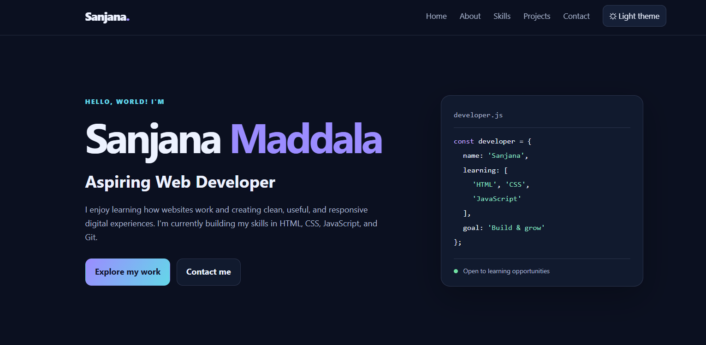
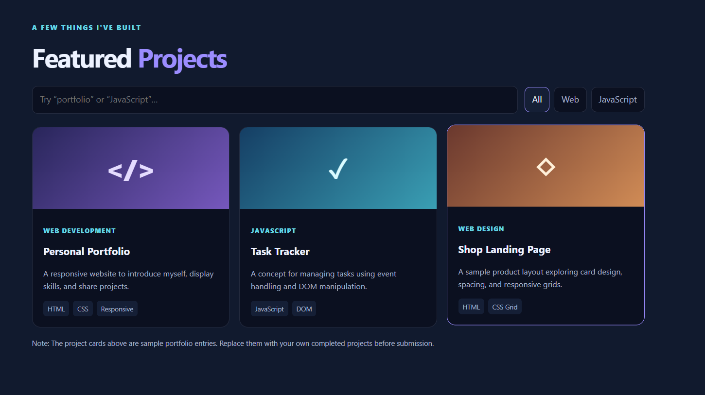
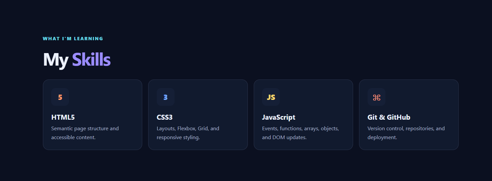

# Final Project Report: Personal Portfolio Website

## 1. Project Objective

The objective of this project is to develop a responsive and interactive Personal Portfolio Website using HTML5, CSS3, and JavaScript. The project also demonstrates the use of Git and GitHub for version control and GitHub Pages for deploying a website online.

## 2. Project Overview

The Personal Portfolio Website provides a platform to introduce the developer, showcase technical skills, display projects, and provide contact information. The website contains Home, About, Skills, Projects, and Contact sections.

The layout is designed to provide a user-friendly experience across desktop, tablet, and mobile screen sizes. The project is organized into separate HTML, CSS, and JavaScript files to improve readability and maintainability.

## 3. Technologies Used

- **HTML5:** Used to create the structure and content of the website.
- **CSS3:** Used for styling, responsive layouts, transitions, and visual design.
- **JavaScript:** Used to implement interactive features, project filtering, theme switching, navigation behavior, and form validation.
- **Git:** Used to track project changes and maintain commit history.
- **GitHub:** Used to store and manage the source code repository.
- **GitHub Pages:** Used to publish the website online.

## 4. Main Features

The website includes responsive navigation, Home, About, Skills, Projects, and Contact sections. It also includes a light/dark theme toggle, searchable project cards, category-based project filtering, a dynamic copyright year, and client-side contact form validation.

The website uses a responsive layout to improve usability on different screen sizes. The contact form demonstrates front-end validation; it does not send messages to a server.

## 5. Website Screenshots

## 5. Website Screenshots

### 5.1 Home Page
The home page introduces the portfolio and provides navigation to the main sections of the website.

### 5.2 Featured Projects
The Featured Projects section displays project cards to showcase development work.

### 5.3 My Skills
The My Skills section presents the technical skills displayed on the portfolio website.

## 6. GitHub Repository and Live Website

**GitHub Repository:**  
https://github.com/SanjanaMaddala11/personal-portfolio

**Live Website:**  
https://sanjanamaddala11.github.io/personal-portfolio/

## 7. Challenges Faced

One of the main challenges in developing a portfolio website is making the layout suitable for different screen sizes. Another challenge is coordinating interactive features such as project searching, category filtering, theme switching, and form validation.

Using responsive CSS techniques and JavaScript event handling helps address these requirements. Organizing the code into separate files also makes the project easier to understand and maintain.

## 8. Solutions Implemented

The website separates its structure, styling, and interactive behavior into HTML, CSS, and JavaScript files. CSS classes and responsive layout techniques help maintain a consistent design. JavaScript handles user interactions and updates website elements when users interact with the available controls.

Git and GitHub were used to track and publish the project, and GitHub Pages was used to make the website accessible online.

## 9. Key Learnings

Through this project, I gained practical experience in creating a website with HTML, CSS, and JavaScript. I learned about responsive web design, page